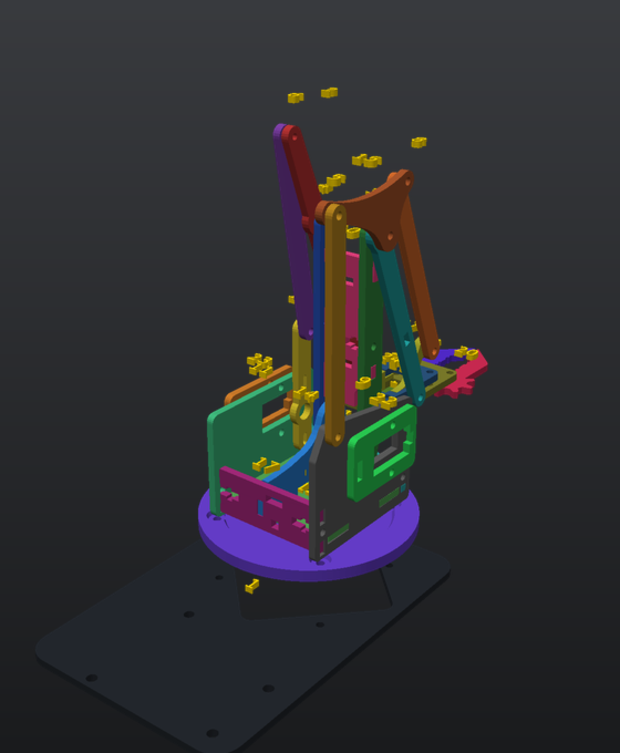
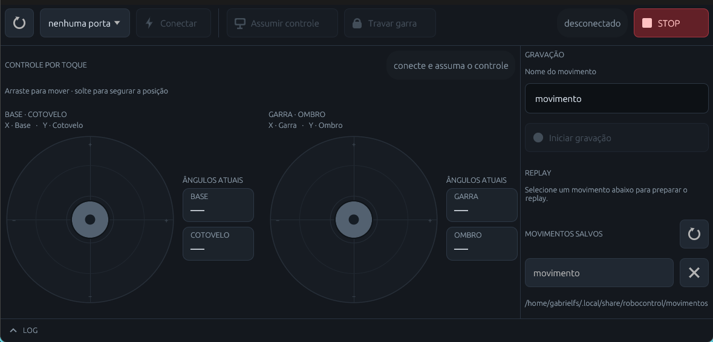

<div align="center">
  
</div>

<h1 align="center">Braço Robótico 4-DOF</h1>

<p align="center">Quatro eixos, dois joysticks e um app que grava e repete movimentos.<br>
Peças em PLA na Bambu Lab A1, firmware Arduino e controle híbrido.</p>

<p align="center">
  <a href="https://gabriel-freitas-s.github.io/braco-robortico/">Página do projeto</a> ·
  <a href="docs/manual_braco_robotico.html">Manual</a> ·
  <a href="docs/guia_montagem.md">Guia de montagem</a> ·
  <a href="impressao/pratos/fatiados/">Pratos fatiados</a>
</p>

---

## O que é

Braço de 4 eixos — base (Yaw), ombro, cotovelo e garra — com um SG90 por
articulação. O app desktop (Rust + egui) propõe alvos; o firmware executa com
rampa, limites mecânicos e hold. Se o USB perder um comando, o braço não dá
tranco. O joystick físico tem a palavra final: ao tocá-lo, a placa retoma o
controle.

- **29 peças** (27 numeradas + H1/H2) impressas em PLA preto.
- **2 pratos**, ~102 g e ~4h13 de impressão na A1.
- **Gravação e replay** de movimentos direto no app.
- **Firmware híbrido**: PC e joystick no mesmo barramento, com transferência
  suave de controle.

## Estado atual (nov/2026)

| Peça | Situação |
|---|---|
| **04** Tirante do paralelogramo | geometria nova, encaixe de 10 mm, furos a 80 mm |
| **12** Mesa giratória | Turret V7 Redonda, 86 mm |
| **H1** Haste de olhal | peça nova — manivela no Servo 4 |
| **H2** Haste curta | peça nova — biela até o dedo móvel |
| **26** Engrenagem acionadora | **removida** do projeto |

A garra passou a ser acionada por link: servo → H1 → H2 → dedo móvel. Os dedos
20 e 21 continuam se acertando pelo setor dentado.

## Imprimir

Perfil `0.20mm Standard @BBL A1`, PLA Basic Preto, bico de 0,4 mm, Textured PEI.

| Prato | Peças | Tempo | Filamento |
|---|---:|---:|---:|
| 1 · Chassi, base e torres | 9 | 2h 10min | 66,3 g |
| 2 · Braço, bielas e garra | 20 | 2h 03min | 36,0 g |
| **Total** | **29** | **~4h 13min** | **~102,3 g** |

- Pratos prontos: [`impressao/pratos/fatiados/`](impressao/pratos/fatiados/)
- Peças individuais fatiadas: [`impressao/pecas_fatiadas/`](impressao/pecas_fatiadas/)
- STLs para re-fatiar: [`impressao/pecas/`](impressao/pecas/)

## Montar

1. **Chassi, base e Yaw** — 01, 17, 18, 25, 16, 12. Calibre o Servo 1 em 90° antes de fechar a mesa.
2. **Torres centrais** — 09, 11, 14, 22, 23. Servos 2 e 3 espelhados, dois M3×30 no espaçador.
3. **Braço e paralelogramo** — 02, 03, 04, 05, 06, 07, 08, 10, 13. Nyloc sem prensar o PLA.
4. **Cabeçote e garra** — 15, 19, 20, 21, 24, 27, 28, H1, H2. Servo 4 em 0° antes de montar a manivela.

O passo a passo com fotos está no [manual](docs/manual_braco_robotico.html). O
[guia de montagem](docs/guia_montagem.md) resume hardware, calibração e a
checagem de interferência do modelo.

## Requisitos

- **Rust** stable + `cargo` (edition 2021).
- **Arduino Uno** + cabo USB.
- **Linux:** usuário no grupo `dialout` (Arch: `uucp`) e bibliotecas de build
  (`pkg-config`, `libudev-dev`, `libxkbcommon-dev`, `libwayland-dev`,
  `libx11-dev`, `libxcursor-dev`, `libxrandr-dev`, `libxi-dev`, `libgl1-mesa-dev`
  no Debian/Ubuntu; equivalentes na sua distro).
- **Windows:** Rust MSVC + *Desktop development with C++* (Visual Studio Build
  Tools) e driver CH340 se a placa for clone.
- **macOS:** Rust + Xcode Command Line Tools (`xcode-select --install`).

O app é nativo (Rust + egui) e roda nos três sistemas. O `install.sh` cria o
atalho no menu **só no Linux**; nos outros, use `cargo run --release`.

## Rodar o app

### Linux

```bash
sudo usermod -aG dialout "$USER"   # relogue depois; no Arch use uucp
cd app && cargo run --release
```

Instalação no menu (opcional): `cd app && ./install.sh`.
Porta típica: `/dev/ttyACM0` ou `/dev/ttyUSB0`.
Movimentos: `~/.local/share/robocontrol/movimentos` (ou `$XDG_DATA_HOME/...`).

### macOS

```bash
xcode-select --install   # uma vez, se ainda não tiver as CLT
cd app && cargo run --release
```

Porta típica: `/dev/cu.usbmodem*` ou `/dev/cu.wchusbserial*` (clone CH340).
Sem permissão extra. Movimentos: `~/.local/share/robocontrol/movimentos`.

### Windows (PowerShell)

```powershell
cd app
cargo run --release
# ou: cargo build --release; .\target\release\robocontrol.exe
```

Porta típica: `COM3`, `COM4`… (Gerenciador de Dispositivos). Clone CH340 precisa
do driver do fabricante. Movimentos: `%APPDATA%\robocontrol\movimentos`.

Em qualquer sistema: escolha a porta → **Conectar** → **Assumir controle (PC)**.

## Firmware

Arduino Uno, sketch `firmware/braco_4dof/braco_4dof.ino` (usa só `Servo.h` e
`EEPROM.h`, ambas do core AVR).

- **Arduino IDE:** abra o sketch, selecione *Arduino Uno* e a porta, clique em Upload.
- **arduino-cli:**

```bash
arduino-cli core install arduino:avr
arduino-cli compile --fqbn arduino:avr:uno firmware/braco_4dof
arduino-cli upload -p /dev/ttyACM0 --fqbn arduino:avr:uno firmware/braco_4dof
```

No Windows troque `/dev/ttyACM0` por `COM3`; no macOS, por `/dev/cu.usbmodem...`.

## Software



- [`app/`](app/) — RoboControl (Rust/egui): dois pads de toque, gravação, replay e log.
- [Documentação do código (rustdoc)](https://gabriel-freitas-s.github.io/braco-robortico/rust/robocontrol/index.html) — API interna do app.
- [`firmware/braco_4dof/`](firmware/braco_4dof/) — firmware Arduino (v1.3.3).
- [`wokwi/`](wokwi/) — simulação do firmware no Wokwi.

## Estrutura

| Pasta | O que guarda |
|---|---|
| `app/` | App desktop de controle |
| `firmware/braco_4dof/` | Firmware Arduino (fonte única) |
| `wokwi/` | Simulação do firmware |
| `cad-output/` | Fonte CAD: STEP + STL por peça |
| `bambu-output/` | Reparos, orientação e previews de impressão |
| `impressao/` | Peças, fatiados e os 2 pratos |
| `montagens/` | Modelo montado/numerado e o gerador |
| `docs/` | Manual, guia e imagens |
| `ref/mdf/` | Modelo de referência em MDF |

## Créditos

As peças 3D deste projeto foram modeladas a partir do modelo de referência
[**“Aula 21 - Braço Robótico”**](https://sketchfab.com/3d-models/aula-21-braco-robotico-03d7364f2f02487a9c4deec73801e46a),
de **Robótica Paraná** ([@roboticaparana](https://sketchfab.com/roboticaparana)),
publicado no Sketchfab sob licença
[**CC BY 4.0**](https://creativecommons.org/licenses/by/4.0/).

As peças foram remodeladas, dimensionadas para impressão 3D e adaptadas à Bambu
Lab A1. Os arquivos de referência ficam em [`ref/mdf/`](ref/mdf/) com este
crédito. O modelo original não é de autoria deste projeto.
